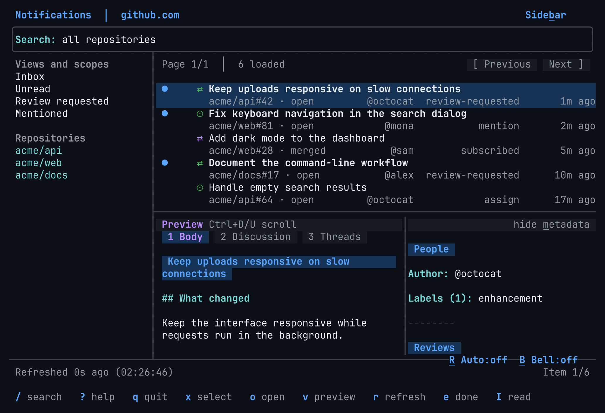

# gh-notifs

Your GitHub inbox, in the terminal. Browse notifications, preview conversations, and filter what needs your attention.
Use the keyboard, mouse, or Unix pipes.



*Recorded with fictional notifications.*

## Install

Install [GitHub CLI](https://cli.github.com/), then run:

```sh
gh auth login # Skip if already authenticated.
gh extension install aymanbagabas/gh-notifs
gh notifs
```

Update with `gh extension upgrade notifs`.
For standalone use, download a binary from [Releases](https://github.com/aymanbagabas/gh-notifs/releases/latest) and put it on your PATH as `gh-notifs`.
Use `gh-notifs.exe` on Windows. On macOS and Linux, run `chmod +x gh-notifs`.
Both forms use GitHub CLI credentials.

## Use

Inside a repository, the inbox defaults to that repository. Use `--global` for your full inbox.

```sh
gh notifs --global
gh notifs -R cli/cli
gh notifs --org acme
gh notifs --global -q 'is:unread reason:review-requested'
gh notifs --global -q 'author:@me since:2026-10-01'
gh notifs --auto-refresh --bell
gh notifs --no-auto-refresh --no-bell
gh notifs --config path/to/inbox.yml
```

Press `/` to filter. Completions help you choose repositories, authors, reasons, types, states, and dates.
Use `is:issue` for issues, `is:pr` for pull requests, or `is:issue-or-pull-request` for both.
Repeated values within a group are alternatives; different groups must all match.
Quote title phrases, such as `"slow uploads"`.

| Key | Action |
| --- | --- |
| Up / Down, `k` / `j` | Move between notifications |
| `/` | Edit the query |
| `Tab` | Switch between the list and sidebar |
| `v` | Toggle the preview |
| `1` / `2` / `3` | Body / Discussion / Threads |
| `Enter` | Open in the browser |
| `x` | Toggle selection |
| `Shift+I` | Mark read |
| `e` | Mark done, after confirmation |
| `[` / `]` | Previous / next page |
| `r` | Refresh |
| `Shift+R` / `Shift+B` | Toggle automatic refresh / bells for this session |
| `Esc` / click error | Dismiss the oldest error; queued errors appear in order |
| `?` / `q` | Help / Quit |
| `Ctrl+Z` | Suspend on macOS/Linux; run `fg` to resume |

Click rows to focus them, click checkmarks to select them, and drag dividers to resize panes.
Drag the preview or help top border to change its height. Sizes last for the session.
Supported terminals change the pointer shape over controls and during a drag.
Previews do not mark notifications read. Opening GitHub in a browser can.
Mark-read and mark-done update the inbox before the API responds. Failed changes revert and show an error.
Subscription actions show a pending label until the API responds.
Cached notifications and repository history can contain private information.

From a source checkout, run `go run ./examples/inbox` to try actions with fictional notifications.
In that example, press `Ctrl+Z` to return to the shell, then run `fg` to restore the same inbox.

## Script

`list` prints TSV. Use `--header` for column names and `-L` to limit results.

```sh
gh notifs list --global -L 10 --header
gh notifs list --global -q 'is:unread' | cut -f8,11
gh notifs list -R cli/cli -L 1 | gh notifs open
```

**Check the targets before you run an action.** CLI actions change GitHub immediately.
Use notification thread IDs, not issue or pull request numbers.

```sh
gh notifs list -R cli/cli -q 'is:unread' -L 10 > selected.tsv
cut -f1,8,11 selected.tsv
gh notifs read < selected.tsv
```

`done`, `subscribe`, and `unsubscribe` also accept IDs or TSV rows. Do not include a header in action input.
Use `gh notifs --help` or `gh notifs help read` for more options.

## Customize

The inbox creates `gh-notifs/config.yml` in your user configuration directory.
Restart after edits.

```yaml
auto_refresh: true
bell: true

scopes:
  - name: Inbox
    query: ""
  - name: My reviews
    query: "is:unread reason:review-requested"
```

Each sidebar scope replaces the complete query when you select it.
Automatic refresh and bells default to `false`; the example enables both.

## License

[MIT](LICENSE).
