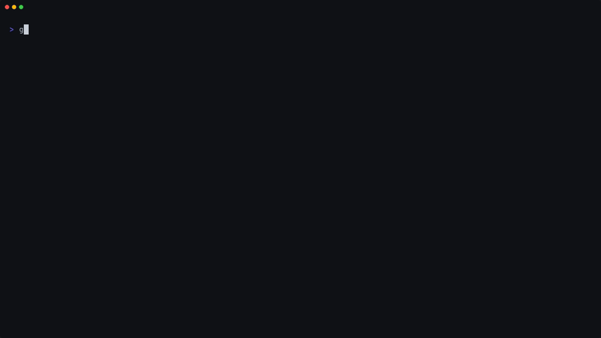

# gh-notifs

A [gh](https://cli.github.com) extension that lists the issues and pull
requests that have changes you did not see, newest first. Choose them in fzf
with a preview, print them for a script or another picker, or watch them on
the full screen.



The demo uses fake data.

## Install

```sh
gh extension install aymanbagabas/gh-notifs
```

Then run `gh notifs`. To update it, run `gh extension upgrade notifs`. The
picker needs fzf 0.63 or later.

To change the script, install it from a clone. gh then runs the clone:

```sh
git clone https://github.com/aymanbagabas/gh-notifs
cd gh-notifs
gh extension install .
```

## Usage

```sh
gh notifs                                  # choose items in fzf, and open them
gh notifs --me                             # only the items that you opened
gh notifs list --review-requested -n 10    # print the 10 newest unread review requests
gh notifs list | gum choose | gh notifs open
gh notifs watch -i 30                      # refresh on the full screen every 30 seconds
```

In a GitHub repository, gh notifs lists only that repository. In other
directories, it lists all repositories. Run `gh notifs --help` for all the
commands, options, filters, and output fields.

## How it works

gh notifs uses the GraphQL search API. An issue or pull request is unread when
`isReadByViewer` is false. This is the same read state as its notification in
the GitHub inbox. So gh notifs does not use the notifications API, and it keeps
no cache.

These limits apply:

- It shows only issues and pull requests. Other notification types, such as
  discussions and releases, have no read state in GraphQL.
- A search gives at most 1,000 items.
- An item that you never opened is also unread.

## Demo

`demo/gh` is a fake gh. It answers from `demo/data.json`. To record the demo
again, run `vhs demo/demo.tape` in the root of the repository. You need VHS
0.12.1 or later, jq, fzf, and gum.
